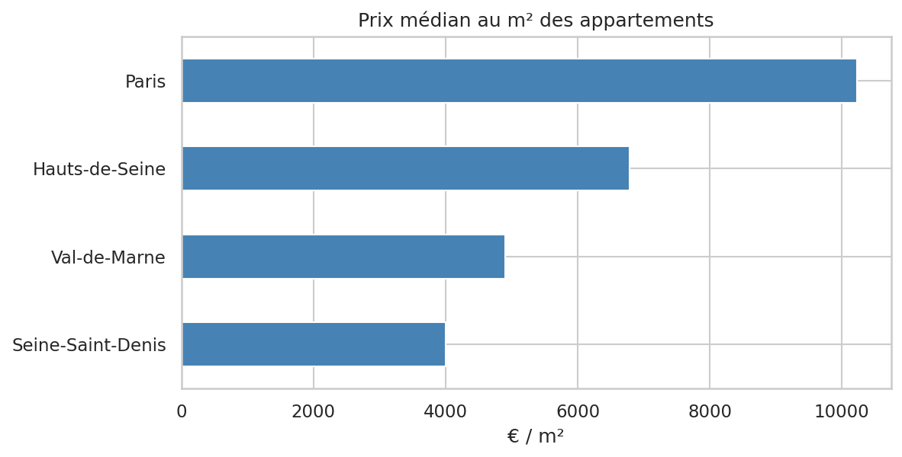
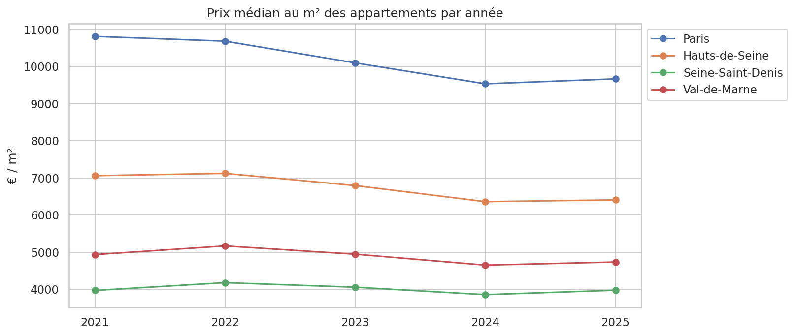
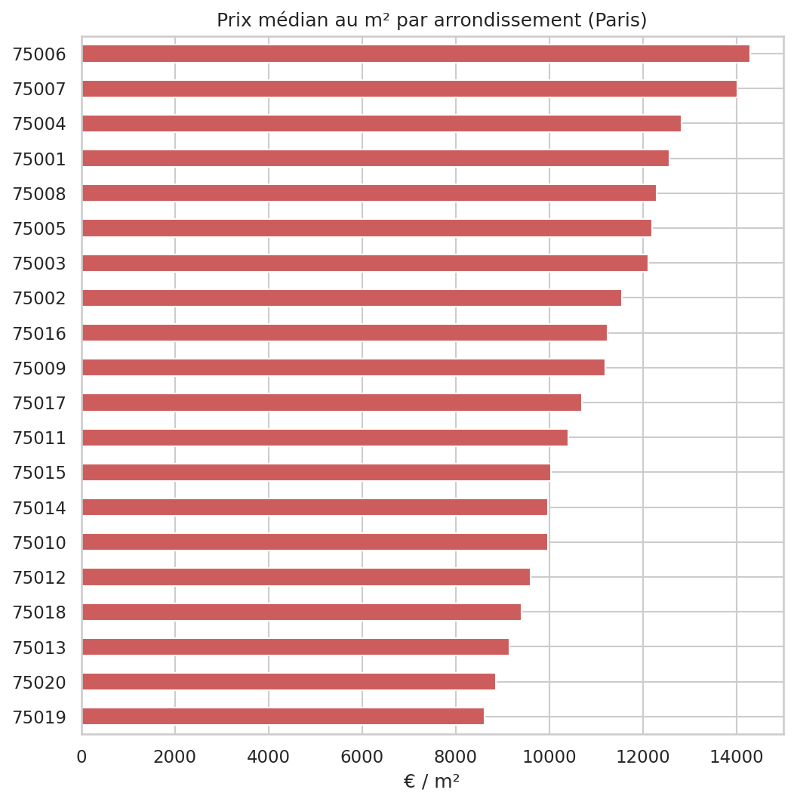
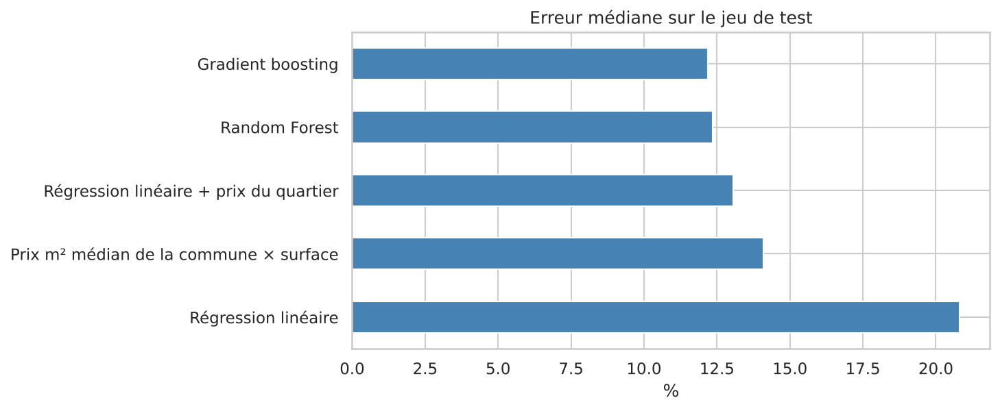
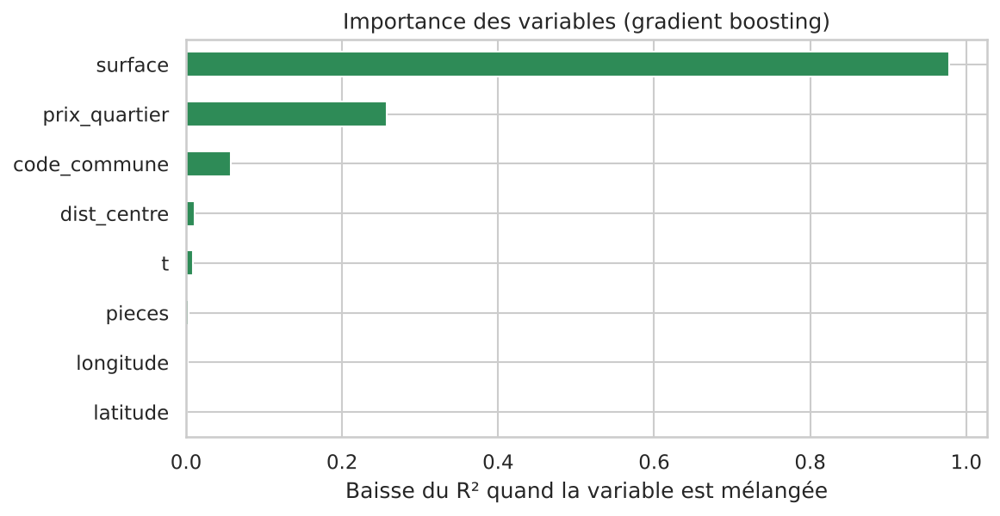
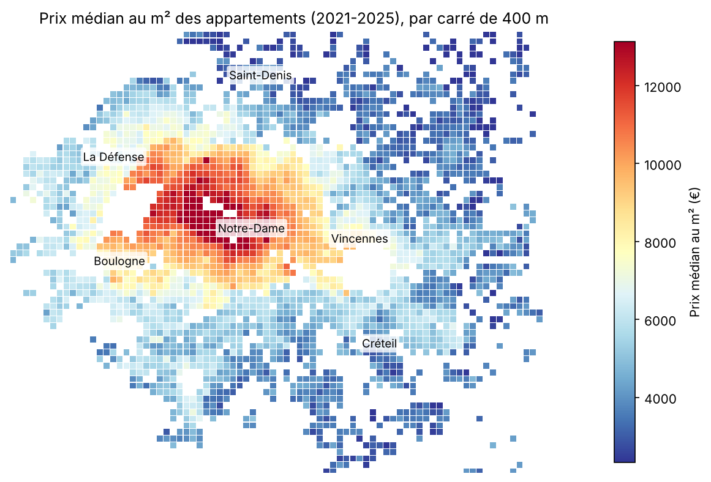

# Prix de l'immobilier en Île-de-France

Analyse des ventes immobilières à Paris et en petite couronne à partir des données DVF (Demandes de Valeurs Foncières), publiées par la DGFiP sur data.gouv.fr. Le projet se termine par un modèle qui estime le prix d'un appartement à partir de sa surface, de son nombre de pièces, de sa localisation et de la date de vente.

**Résultat principal :** le modèle estime la moitié des appartements avec moins de **12,2 % d'erreur**, et 72 % à moins de 20 % près.

## Données

J'utilise la version géolocalisée des DVF ([lien](https://www.data.gouv.fr/fr/datasets/demandes-de-valeurs-foncieres-geolocalisees/)), qui recense toutes les ventes immobilières avec leurs coordonnées GPS.

- Départements : Paris (75), Hauts-de-Seine (92), Seine-Saint-Denis (93), Val-de-Marne (94)
- Période : 2021 à 2025
- Volume : 1,29 million de lignes brutes, 368 217 ventes gardées après nettoyage (321 249 appartements et 46 968 maisons)

Les fichiers sont trop lourds pour être mis sur GitHub, ils se téléchargent avec `src/download_data.py`.

## Le nettoyage

C'est la partie qui m'a pris le plus de temps à comprendre. Dans les DVF, une vente (une « mutation ») peut être répartie sur plusieurs lignes : l'appartement, la cave, la place de parking, parfois un deuxième lot. Le problème, c'est que chaque ligne reprend le **prix total** de la vente. Si on calcule un prix au m² ligne par ligne, on obtient des valeurs complètement fausses.

J'ai donc gardé uniquement :
- les ventes classiques (pas les échanges ni les adjudications) ;
- les ventes qui contiennent un seul logement, appartement ou maison ;
- les biens entre 9 et 500 m² ;
- les prix au m² compris entre le 1er et le 99e percentile, calculés par département et par type de bien ;
- les ventes dont les coordonnées GPS sont manifestement fausses (286 ventes situées par exemple en Méditerranée ou dans l'Arctique). Je ne les avais pas repérées au début : c'est en construisant la carte des prix qu'elles sont apparues.

Au final, moins d'un tiers des lignes de départ sont exploitables.

## Résultats

### Paris coûte 2,5 fois plus cher que la Seine-Saint-Denis

Prix médian au m² des appartements sur la période :

| Département | Prix médian au m² |
|---|---|
| Paris | 10 234 € |
| Hauts-de-Seine | 6 781 € |
| Val-de-Marne | 4 904 € |
| Seine-Saint-Denis | 4 000 € |



### Les prix baissent depuis 2022

| Département | Plus haut | 2024 | Variation | 2025 |
|---|---|---|---|---|
| Paris | 10 810 € (2021) | 9 533 € | −11,8 % | 9 667 € |
| Hauts-de-Seine | 7 121 € (2022) | 6 360 € | −10,7 % | 6 407 € |
| Val-de-Marne | 5 167 € (2022) | 4 652 € | −10,0 % | 4 735 € |
| Seine-Saint-Denis | 4 179 € (2022) | 3 856 € | −7,7 % | 3 974 € |

Ce sont les départements les plus chers qui ont le plus baissé. La chute correspond à la hausse des taux d'emprunt en 2022-2023. En 2025, les prix remontent un peu partout, mais il faut rester prudent : les données de l'année la plus récente ne sont pas toujours complètes.



### Maisons et appartements : un piège dans la comparaison

Le prix médian au m² est de 5 118 € pour les maisons et de 7 647 € pour les appartements. On pourrait conclure que les maisons sont moins chères, mais c'est un effet de composition : les maisons se trouvent presque toutes en petite couronne, là où les prix sont plus bas, alors qu'à Paris on ne vend quasiment que des appartements. Pour comparer correctement, il faut raisonner à localisation égale, ce que fera le modèle.

### À Paris, l'écart entre arrondissements reste important

Le 6e (14 286 €/m²) et le 7e (14 014 €/m²) sont les plus chers. À l'autre bout, le 19e (8 622 €/m²) et le 20e (8 854 €/m²) coûtent environ 40 % de moins. Les arrondissements du centre et de la rive gauche sont tous au-dessus de 12 000 €/m², ceux du nord-est en dessous de 10 000 €/m².



## Modélisation

Notebook : `notebooks/02_modelisation.ipynb`. Je me limite aux appartements (321 249 ventes), découpés en 80 % pour l'entraînement et 20 % pour le test. La cible est le log du prix, pour que le modèle soit bon en pourcentage sur les petits comme sur les grands biens.

La variable la plus utile n'existe pas dans les données, je l'ai construite : le **prix au m² des 30 ventes les plus proches** (`prix_quartier`). Pour éviter toute fuite de données, elle est calculée en validation croisée sur le train, et uniquement à partir du train pour le test.

| Méthode | Erreur médiane | MAE | R² |
|---|---|---|---|
| Prix m² médian de la commune × surface | 14,1 % | 84 667 € | 0,820 |
| Régression linéaire | 20,8 % | 118 765 € | 0,691 |
| Régression linéaire + prix du quartier | 13,1 % | 84 437 € | 0,795 |
| Random Forest | 12,4 % | 80 483 € | 0,811 |
| Gradient boosting | **12,2 %** | **80 078 €** | 0,806 |



Ce que j'en retiens :
- **La méthode « agent immobilier » est un point de comparaison exigeant.** Prix au m² de la commune × surface donne déjà 14,1 % d'erreur médiane. Le gradient boosting gagne 2 points : c'est réel, mais modeste.
- **Le travail sur les variables compte plus que le choix du modèle.** Avec `prix_quartier`, une simple régression linéaire passe de 21 % à 13 % d'erreur.
- **Je juge les modèles sur l'erreur médiane plutôt que sur le R².** Le R² en euros est dominé par les biens les plus chers et ne départage pas les modèles ici.
- **Paris est le plus difficile à prédire** : 14,3 % d'erreur médiane, contre 10 à 12 % en petite couronne. Les très petites (< 25 m²) et très grandes (> 100 m²) surfaces aussi.



Limites : les DVF ne disent rien de l'étage, de l'état du bien ou des équipements, et contiennent des ventes atypiques (viager, ventes familiales) impossibles à repérer. Une partie de l'erreur est donc incompressible avec ces données. Le découpage train/test étant aléatoire, il faudrait aussi valider sur une période future pour un usage réel.

## Carte des prix



Chaque carré fait environ 400 m de côté et n'est affiché que s'il contient au moins 10 ventes. On voit bien le centre et l'ouest parisien au-dessus de 12 000 €/m², le prolongement des prix élevés vers Neuilly, Boulogne et Vincennes, et la cassure au nord et à l'est du périphérique.

Une version interactive (zoom, prix au survol) est générée avec Folium par `python src/carte.py`, dans `reports/carte_prix_m2.html`.

## Application d'estimation

`app.py` est une petite application Streamlit : on entre une adresse, une surface et un nombre de pièces, et elle renvoie une estimation du prix. L'adresse est géolocalisée avec l'API Adresse de l'IGN (gratuite, sans clé), puis le modèle calcule le prix du quartier et l'estimation.

```bash
streamlit run app.py
```

## Organisation du projet

```
prix-immobilier-france/
├── data/
│   ├── raw/              # fichiers DVF téléchargés (non versionnés)
│   └── processed/        # données nettoyées (non versionnées)
├── notebooks/
│   ├── 01_exploration.ipynb
│   └── 02_modelisation.ipynb
├── src/
│   ├── download_data.py
│   ├── cleaning.py
│   ├── carte.py
│   └── estimation.py
├── models/              # modèle entraîné
├── reports/figures/
├── app.py               # application Streamlit
├── requirements.txt
└── README.md
```

## Lancer le projet

```bash
git clone https://github.com/<username>/prix-immobilier-france.git
cd prix-immobilier-france

conda create -n immo python=3.11 -y
conda activate immo
pip install -r requirements.txt

python src/download_data.py
```

Ensuite, lancer les notebooks dans l'ordre : `01_exploration.ipynb` puis `02_modelisation.ipynb`.

## Suite du projet

- [x] Modèle de prédiction
- [x] Carte des prix au m²
- [x] Application d'estimation
- [ ] Mettre l'application en ligne (Streamlit Community Cloud)
- [ ] Valider le modèle sur une période future (entraînement sur 2021-2024, test sur 2025)

## Outils

Python, Pandas, NumPy, Matplotlib, Seaborn, Scikit-learn, Folium, Streamlit

---

Mamoun Safrioui, étudiant ingénieur en data science à CY Tech
